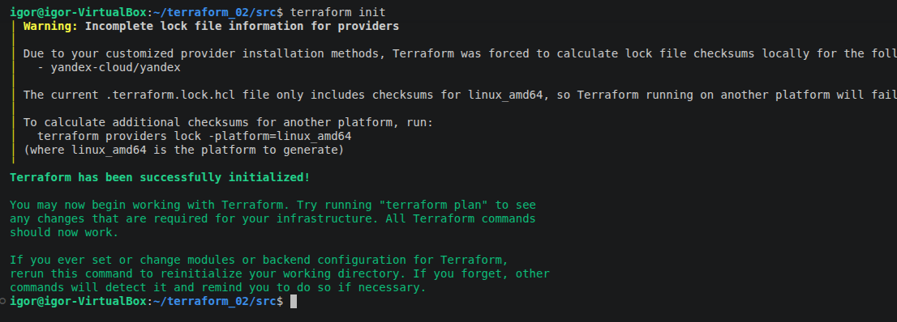
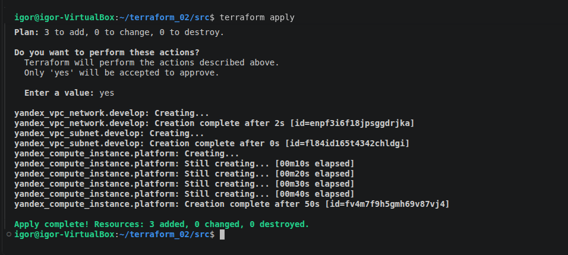
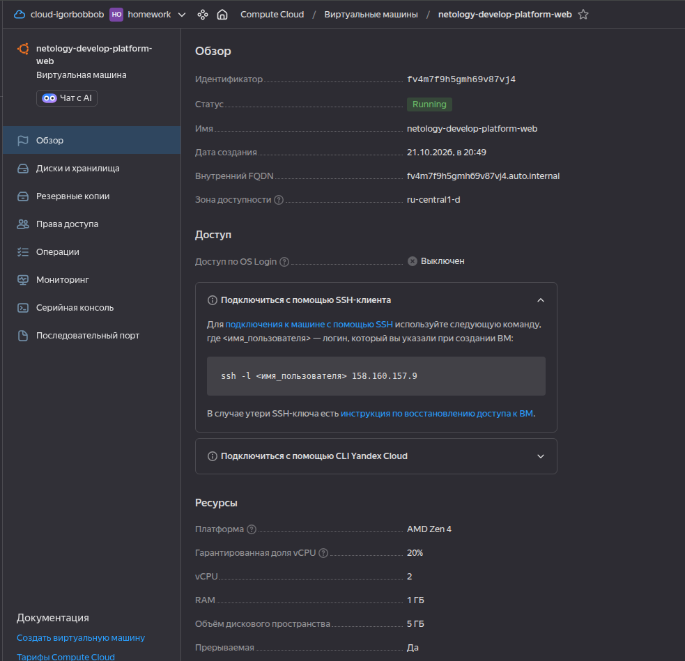
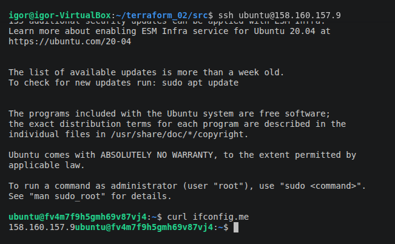
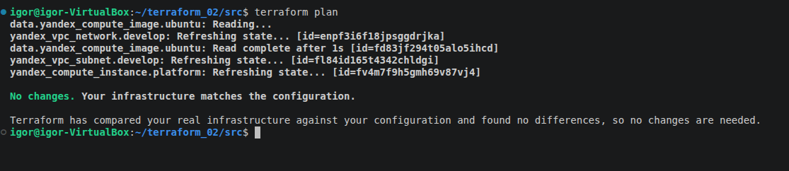
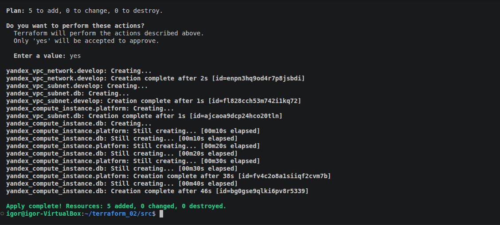
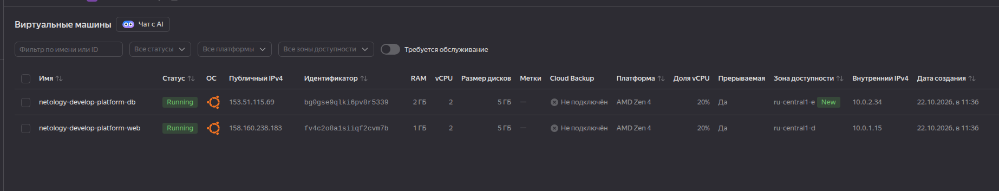
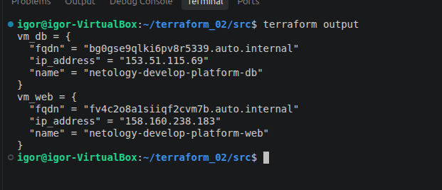
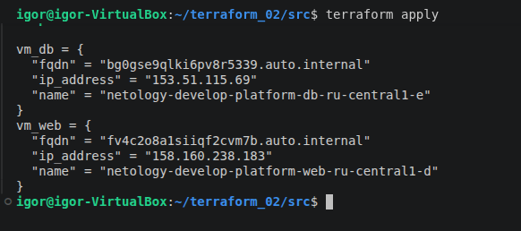
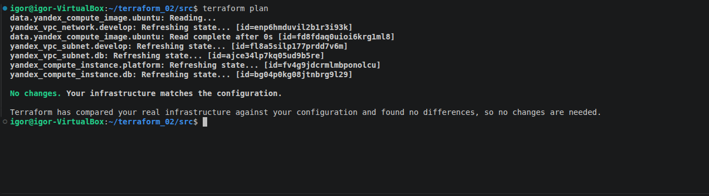

# Домашнее задание к занятию «Основы Terraform. Yandex Cloud»

### Цели задания

1. Создать свои ресурсы в облаке Yandex Cloud с помощью Terraform.
2. Освоить работу с переменными Terraform.


### Чек-лист готовности к домашнему заданию

1. Зарегистрирован аккаунт в Yandex Cloud. Использован промокод на грант.
2. Установлен инструмент Yandex CLI.
3. Исходный код для выполнения задания расположен в директории [**02/src**](https://github.com/netology-code/ter-homeworks/tree/main/02/src).


### Задание 0

1. Ознакомьтесь с [документацией к security-groups в Yandex Cloud](https://cloud.yandex.ru/docs/vpc/concepts/security-groups?from=int-console-help-center-or-nav). 
Этот функционал понадобится к следующей лекции.

------
### Внимание!! Обязательно предоставляем на проверку получившийся код в виде ссылки на ваш github-репозиторий!
------

### Задание 1
В качестве ответа всегда полностью прикладывайте ваш terraform-код в git.
Убедитесь что ваша версия **Terraform** ~>1.12.0

1. Изучите проект. В файле variables.tf объявлены переменные для Yandex provider.
2. Создайте сервисный аккаунт и ключ. [service_account_key_file](https://terraform-provider.yandexcloud.net).
4. Сгенерируйте новый или используйте свой текущий ssh-ключ. Запишите его открытую(public) часть в переменную **vms_ssh_public_root_key**.
5. Инициализируйте проект, выполните код. Исправьте намеренно допущенные синтаксические ошибки. Ищите внимательно, посимвольно. Ответьте, в чём заключается их суть.
6. Подключитесь к консоли ВМ через ssh и выполните команду ``` curl ifconfig.me```.
Примечание: К OS ubuntu "out of a box, те из коробки" необходимо подключаться под пользователем ubuntu: ```"ssh ubuntu@vm_ip_address"```. Предварительно убедитесь, что ваш ключ добавлен в ssh-агент: ```eval $(ssh-agent) && ssh-add``` Вы познакомитесь с тем как при создании ВМ создать своего пользователя в блоке metadata в следующей лекции.;
8. Ответьте, как в процессе обучения могут пригодиться параметры ```preemptible = true``` и ```core_fraction=5``` в параметрах ВМ.

В качестве решения приложите:

- скриншот ЛК Yandex Cloud с созданной ВМ, где видно внешний ip-адрес;
- скриншот консоли, curl должен отобразить тот же внешний ip-адрес;
- ответы на вопросы.


### Решение

1. Проект изучен.

2. Сервисный аккаунт и ключ созданы.

3. ssh-ключ записан в переменную **vms_ssh_public_root_key**.

4. Проект иницилизирован:



В процессе выполнения кода terraform указывает на ошибки:

- требует значение перменной ```var.cloud_id```. Значение по умолчанию добавлено в [variables.tf](/src/variables.tf) 

- требует значение перменной ```var.folder_id```. Значение по умолчанию добавлено в [variables.tf](/src/variables.tf) 

- ошибка ```Platform "standart-v4" not found```. Заменено на ```standard-v4a``` в `[main.tf](/src/main.tf) 
 
- ошибка ```core fraction```. Для ```standard-v4a``` Допустимо значение 20, 50, или 100. Заменено на ```20``` в `[main.tf](/src/main.tf) 

- ошибка ```number of cores```. Для ```standard-v4a``` Допустимо значение 2 или 4. Заменено на ```2``` в `[main.tf](/src/main.tf) 

- т.к. ЯО работае с ограничениями значение переменной "default_zone" заменено на "ru-central1-d"

После внесения изменений код выполнился успешно:



В ЛК видимо созданную ВМ:



5. Подключаемся к консоли ВМ через ssh и выполняем команду ```curl ifconfig.me```



6. Параметры ```preemptible = true``` и ```core_fraction=5``` могут пригодиться в процессе обучения для экономии денежных средств.


### Задание 2

1. Замените все хардкод-**значения** для ресурсов **yandex_compute_image** и **yandex_compute_instance** на **отдельные** переменные. К названиям переменных ВМ добавьте в начало префикс **vm_web_** .  Пример: **vm_web_name**.
2. Объявите нужные переменные в файле variables.tf, обязательно указывайте тип переменной. Заполните их **default** прежними значениями из main.tf. 
3. Проверьте terraform plan. Изменений быть не должно. 


### Решение

Созданы переменные **vm_web_name** и **vm_web_image** в [variables.tf](/src/variables.tf) со дефолтными значениями из main.tf. Хардкод-значения для ресурсов **yandex_compute_image** и **yandex_compute_instance** заменены на переменные в [main.tf](/src/main.tf).

Результат выполнения команды ```terraform plan``` - No changes:




### Задание 3

1. Создайте в корне проекта файл 'vms_platform.tf' . Перенесите в него все переменные первой ВМ.
2. Скопируйте блок ресурса и создайте с его помощью вторую ВМ в файле main.tf: **"netology-develop-platform-db"** ,  ```cores  = 2, memory = 2, core_fraction = 20```. Объявите её переменные с префиксом **vm_db_** в том же файле ('vms_platform.tf').  ВМ должна работать в зоне "ru-central1-b"
3. Примените изменения.


### Решение

1. Создаем [vms_platform.tf](/src/vms_platform.tf), переносим в него переменные первой ВМ:  vm_web_name, vms_ssh_root_key

2. Создаем вторую ВМ в файле [main.tf](/src/main.tf): **"netology-develop-platform-db"**, объявляем ее переменные в [vms_platform.tf](/src/vms_platform.tf). Из-за ограничений ЯО вторая ВМ будет создана в зоне "ru-central1-e" 

3. Применяем изменения:



ЛК Yandex Cloud со второй созданной ВМ:




### Задание 4

1. Объявите в файле outputs.tf **один** output , содержащий: instance_name, external_ip, fqdn для каждой из ВМ в удобном лично для вас формате.(без хардкода!!!)
2. Примените изменения.

В качестве решения приложите вывод значений ip-адресов команды ```terraform output```.


### Решение


1. Объявляем в [outputs.tf](/src/outputs.tf) output:

Вывод команды ```terraform output```:




### Задание 5

1. В файле locals.tf опишите в **одном** local-блоке имя каждой ВМ, используйте интерполяцию ${..} с НЕСКОЛЬКИМИ переменными по примеру из лекции.
2. Замените переменные внутри ресурса ВМ на созданные вами local-переменные.
3. Примените изменения.


### Решение

1. Создаем [locals.tf](/src/locals.tf) c несколькими перменными

2. Заменяем переменные внутри ресурса ВМ на созданные вами local-переменные.

3. Применяем изменения:




### Задание 6

1. Вместо использования трёх переменных  ".._cores",".._memory",".._core_fraction" в блоке  resources {...}, объедините их в единую map-переменную **vms_resources** и  внутри неё конфиги обеих ВМ в виде вложенного map(object).  
   ```
   пример из terraform.tfvars:
   vms_resources = {
     web={
       cores=2
       memory=2
       core_fraction=5
       hdd_size=10
       hdd_type="network-hdd"
       ...
     },
     db= {
       cores=2
       memory=4
       core_fraction=20
       hdd_size=10
       hdd_type="network-ssd"
       ...
     }
   }
   ```
3. Создайте и используйте отдельную map(object) переменную для блока metadata, она должна быть общая для всех ваших ВМ.
   ```
   пример из terraform.tfvars:
   metadata = {
     serial-port-enable = 1
     ssh-keys           = "ubuntu:ssh-ed25519 AAAAC..."
   }
   ```  
  
5. Найдите и закоментируйте все, более не используемые переменные проекта.
6. Проверьте terraform plan. Изменений быть не должно.


### Решение


1. Создаем единую map-переменную **vms_resources** в  и  внутри неё конфиги обеих ВМ [vms_platform.tf](/src/vms_platform.tf)

2. Создаем отдельную map(object) переменную для блока metadata в [vms_platform.tf](/src/vms_platform.tf)

3. Проверяем terraform plan, изменнений нет




